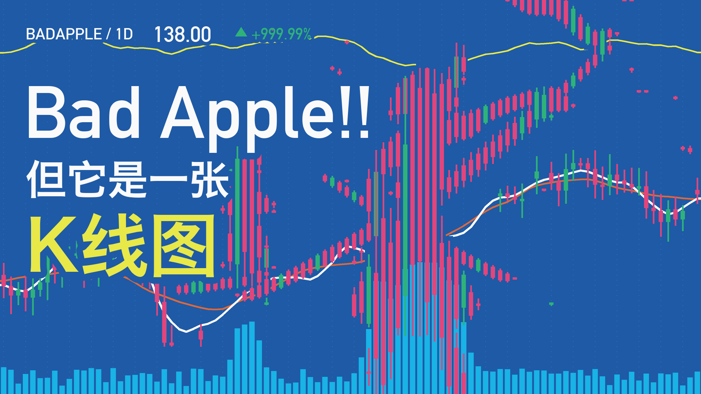
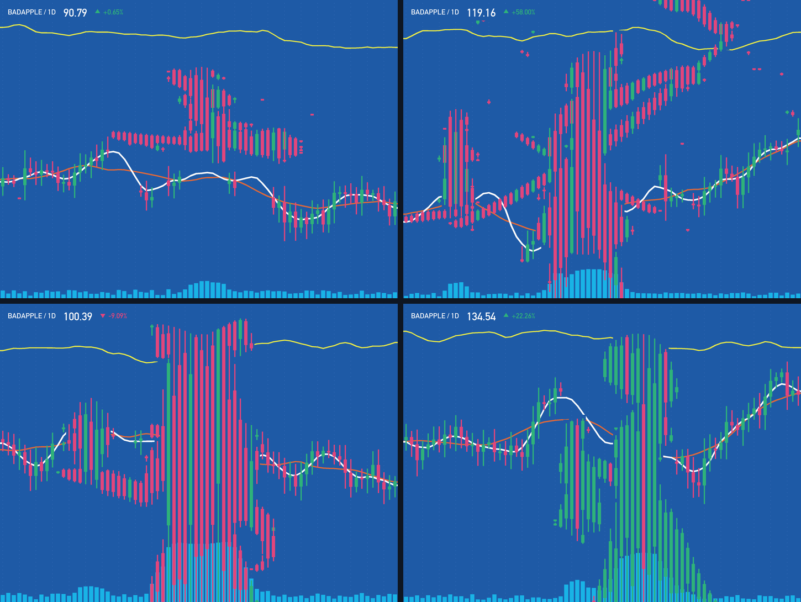

# Bad Apple!! K 线版

用股票 K 线图重绘《Bad Apple!!》影绘 PV。





## 规则

每一个视觉元素都有图表含义，画面首先是一张行情图，人物是从行情里浮现出来的：

- **网格**：72 列等宽等距，每列是一个交易日，满幅出血。
- **蜡烛**：人物在每列里的连续区间决定这根 K 线的最高价和最低价；实体只占其中一段，位置和涨跌交给背景行情。轮廓由影线尖端暗示，不画硬边。
- **插针**：刀尖、发梢这类部分覆盖的边缘画成长影线，更细的线画成插针加十字星。
- **牛熊**：正常画面里人物蜡烛以上涨为主；原片反色时整体翻成下跌。前景极性自动判断，带回差，避免在阈值附近闪烁。
- **背景行情**：留白处是同一尺度的随机游走行情，每 8 帧向左滚动一根，人物周围留出一圈空白。
- **均线**：白线 MA5、橙线 MA20 跟随背景行情，碰到人物就隐入、从另一侧再浮出；黄线是顶部的独立指标。
- **成交量**：每列的人物占比，加上从原曲里提取的节拍（138 BPM），重拍上冲出天量。

## 运行

依赖：Python 3.9+、`numpy`、`Pillow`、`ffmpeg`。

```bash
pip install numpy pillow
```

仓库不包含原片和原曲。请自行准备，放到：

```
src/badapple_video.mp4   # 480x360, 30fps 影绘 PV
src/badapple_audio.m4a   # 原曲音轨
```

然后：

```bash
python3 audio_beats.py                                    # 提取节拍 -> src/beats.npz（可选，没有就不跟拍）
python3 render_video.py --start 56 --dur 10 --cols 72 --out out/clip.mp4 --side-by-side
python3 render_video.py --start 0 --dur 219.0667 --cols 72 --out out/full.mp4
python3 cover_final.py                                    # 生成 16:9 封面候选 -> out/cover/
```

8 核大约 0.06 秒一帧，全片 6,572 帧约 6 分钟，另加编码 2 分钟。

单帧调试：

```bash
python3 candlechart.py some_frame.png out.png 72
```

## 可调参数

都在 `candlechart.py` 顶部：

| 参数 | 作用 |
|---|---|
| `FIG_BODY` | 人物蜡烛实体占区间的比例，越大人物越实，越小越像行情 |
| `HALO` | 人物周围留给背景行情的空白 |
| `BULL` | 正常画面里人物的上涨比例；反色时取 `1 - BULL` |
| `LINE_GAP` / `MIN_HIDE` / `MIN_RUN` | 均线遮罩：让出距离、触发遮罩的最小蜡烛高度、最短可见线段 |
| `PALETTE` | 配色。默认美股绿涨红跌；对调 `up` / `down` 即为 A 股红涨绿跌 |

封面和行情抬头用到 macOS 系统字体（DIN Alternate、冬青黑体）。在其他系统上运行，需要修改 `candlechart.py` 和 `cover_final.py` 里的字体路径，或者设置 `UI = False` 关掉抬头。

## 致谢

- 原作 PV：あにら「Bad Apple!! 影絵」
- 原曲：Alstroemeria Records「Bad Apple!! feat. nomico」（原曲 ZUN，《东方幻想乡》）
- 视觉参考：The New Yorker, *The Pied Piper of SPACs* 题图

本仓库只包含渲染代码。原片、原曲及其衍生的音视频版权归原作者所有。
